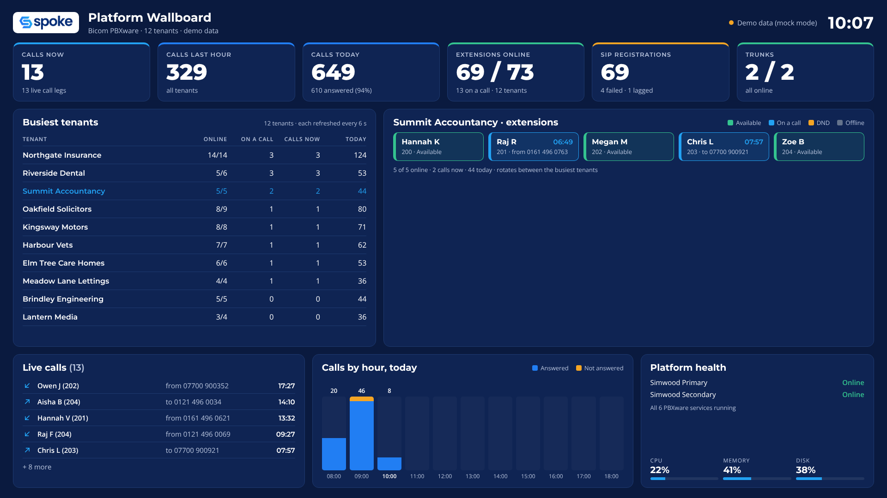

# Spoke Bicom Wallboard

A read-only operations wallboard for Spoke's multi-tenant **Bicom PBXware 7.6** platform. It runs on a small Node
server, polls the PBXware API, and streams one snapshot to any browser or TV in the office.



What it shows:

- Platform calls now, in the last hour and today, extensions online, SIP registrations and trunk status
- The busiest tenants (calls now, agents on a call, extensions online)
- A clickable tenant list (busiest first). The extensions panel opens on the busiest tenant; click any tenant to view its
  extensions (available / on a call / DND / offline). Add `#tenant=<ID>` to the address to pin a TV to one tenant
- Live calls, calls by hour (from CDRs) and platform health (services, CPU, memory, disk)

It is built so a MiRTA data source can replace the Bicom one later without changing the page (see
[docs/ARCHITECTURE.md](docs/ARCHITECTURE.md)).

## Quick start (demo data)

Needs Node 20.12 or later. There are no npm dependencies.

```bash
npm run dev          # mock data on http://127.0.0.1:8080
npm test
```

## Connecting to PBXware

1. **Create a dedicated API key** in PBXware (master tenant): *Admin Settings → API Keys → Add*.
   - Restrict it to the wallboard server's IP address.
   - Grant only the read methods the wallboard uses: `pbxware.tenant.list`, `pbxware.monitor.list`,
     `pbxware.monitor.live_calls`, `pbxware.monitor.trunks`, `pbxware.dashboard.*`, `pbxware.cdr.download`.
   - The client also refuses anything outside that list (`READ_ONLY_ACTIONS` in `src/pbxware/client.js`).
2. `cp .env.example .env` and fill in `PBXWARE_URL`, `PBXWARE_API_KEY`, `WALLBOARD_USER` and `WALLBOARD_PASSWORD`.
3. **Run the probe first:** `npm run probe`. It calls each action once, saves the raw responses to
   `probe-output/` and prints their shapes. The Bicom documentation examples are not always consistent, so check
   the field names against `src/pbxware/normalize.js`. `probe-output/` contains customer names and numbers: it is
   git-ignored, so keep it that way and delete it when you're done.
4. `npm start` and open `http://127.0.0.1:8080`.

## Deploying

On the server (Ubuntu/Debian):

```bash
sudo useradd --system --home /opt/spoke-bicom-wallboard wallboard
sudo git clone https://github.com/1jw-99/spoke-bicom-wallboard /opt/spoke-bicom-wallboard
sudo cp /opt/spoke-bicom-wallboard/.env.example /opt/spoke-bicom-wallboard/.env   # then edit
sudo mkdir -p /opt/spoke-bicom-wallboard/probe-output
sudo chown -R wallboard: /opt/spoke-bicom-wallboard && sudo chmod 600 /opt/spoke-bicom-wallboard/.env
sudo cp /opt/spoke-bicom-wallboard/deploy/spoke-wallboard.service /etc/systemd/system/
sudo cp /opt/spoke-bicom-wallboard/deploy/spoke-wallboard-restart.* /etc/systemd/system/
sudo systemctl daemon-reload && sudo systemctl enable --now spoke-wallboard spoke-wallboard-restart.timer
```

Keep `HOST=127.0.0.1` and put **Caddy** in front for HTTPS (`deploy/Caddyfile.example`). Basic auth protects the
page and the API; `/healthz` is open for monitoring. For a TV, open the page full-screen in a browser (1920×1080).

## Configuration

All settings are in `.env` (see `.env.example`). The main ones:

| Setting | Default | Meaning |
|---|---|---|
| `WALLBOARD_SOURCE` | `pbxware7` | `pbxware7` or `mock` |
| `TENANTS` / `TENANTS_EXCLUDE` | `all` / none | Tenant IDs to include or skip (the master tenant, 1, is always skipped) |
| `POLL_PLATFORM_SECONDS` | 5 | Platform totals, live calls, trunks |
| `POLL_TENANT_CYCLE_SECONDS` | 120 | Time to refresh every tenant once |
| `POLL_CDR_SECONDS` | 60 | Calls-by-hour refresh |
| `FEATURED_TENANTS` | busiest | Tenant ID to open on instead of the busiest (first in the list) |
| `PBXWARE_MAX_CONCURRENCY` | 2 | Maximum API requests in flight |

At the defaults with ~125 tenants the wallboard makes about 3 API requests per second. Raise the intervals if the
PBX dashboard feels slower.

## Known limitations (PBXware 7.6)

- **No queue data.** The 7.6 API has no queue object, so there are no calls waiting, longest wait, paused agents
  or service level. These arrive with the MiRTA version.
- **Live calls aren't tagged with a tenant** at platform level, so the live calls panel shows numbers and names only.
- Agent status comes from extension registration and call state, not from queue log-ins.
- Calls by hour is platform-wide.
